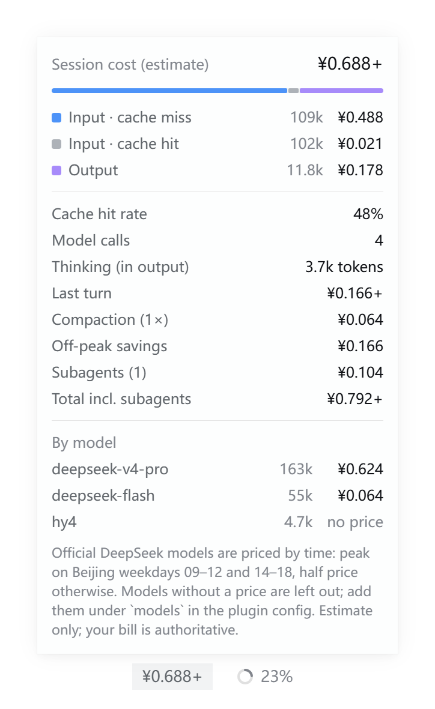
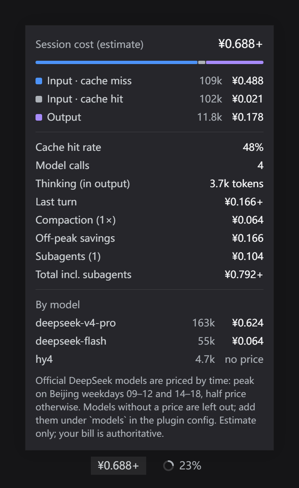
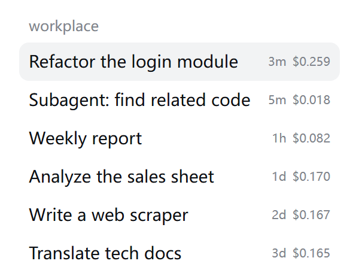

# dsh-token-bill · Conversation cost

[](https://www.npmjs.com/package/dsh-token-bill)
[](LICENSE)
[](https://github.com/deepseek-ai/deepseek-harness)

[中文](README.md)

A [DeepSeek Harness](https://github.com/deepseek-ai/deepseek-harness) plugin that estimates **what every conversation costs**. For anyone using the DeepSeek API or account quota who wants to know what each conversation costs and which hours are cheaper.

**Install**: DeepSeek Harness → **Plugins** → **Add plugin**, enter `dsh-token-bill`. ([details](#install))

- **Under the composer**: the session's estimated cost sits left of the context ring; click it for a breakdown.
- **In the sidebar**: every conversation shows its cost next to its time, without opening it.
- **Per-model pricing**: built-in official DeepSeek prices (`deepseek-flash`, `deepseek-v4-pro`, in CNY and USD); price any other model (for example one routed through pi-ai) in the config.
- **Peak / off-peak aware**: DeepSeek charges peak rates on Beijing weekdays 09:00–12:00 and 14:00–18:00 and half price at all other times (weekends and Chinese public holidays included). Each call is priced by **when it happened**, and the panel shows how much off-peak hours saved.
- **More complete**: counts the model calls made by context compaction (the built-in token meter does not), lists subagent costs with a grand total, and never re-bills the history a forked conversation inherited.
- **Price edits apply at once**: sessions store tokens only and prices are applied when the view is built, so changing a price re-prices every past conversation.
- Chinese and English UI, follows the light / dark theme; no dependencies, no build step.

> Costs are estimated from provider-reported token usage and a price table. Your bill is authoritative.

## Screenshots

| Breakdown panel (light) | Breakdown panel (dark) | Sidebar |
|---|---|---|
|  |  |  |

<sub>2x preview renders of the plugin's code with the DSH theme; the plugin follows DSH's language setting. Sample data: one peak-hour exchange, one night-time (off-peak) exchange, one compaction, one subagent, and one unpriced model (hy4).</sub>

What the panel shows:

| Row | Meaning |
|---|---|
| Input · cache miss / cache hit / Output | Tokens and cost per bucket; the bar shows each bucket's share of the cost. A "Cache write" row appears when there are cache writes. |
| Cache hit rate | Cached input ÷ all input. |
| Model calls | Billed model calls (a failed attempt that was retried counts too). |
| Thinking (in output) | Thinking (reasoning) tokens, already included in Output. |
| Last turn | Cost of the most recent turn. |
| Compaction | Cost of the model calls made while compacting the context. |
| Off-peak savings | What you saved compared with paying peak prices throughout. |
| Subagents / Total incl. subagents | Cost of the subagents this session started, and the total with them. |
| By model | Tokens and cost per model; models without a price show "no price". |

- A trailing `+` means some model has no price configured and is left out of the total (marked "no price").
- The subagent lines appear only when the session started subagents and the sidebar has loaded their data.

## Install

Requires DeepSeek Harness **0.2.2-rc.1 or newer**.

### From the Plugins page (recommended)

DeepSeek Harness sidebar → **Plugins** → **Add plugin**, then enter:

```text
dsh-token-bill
```

Click **Install**, then **Enable now**. The plugin is published on [npm](https://www.npmjs.com/package/dsh-token-bill), so new versions can be updated in one click on the Plugins page.

From the command line: `dsh plugin add dsh-token-bill` (add `--profile <your profile>` if you need one).

> The China mirror (npmmirror) can take a while to pick up a new version. If you don't get the latest one, switch **Registry** in **Add plugin** to the official npm registry.

### Other ways to install

- **From GitHub**: enter `github:leecisen/dsh-token-bill` in **Add plugin** to install the repository's latest code. A plugin installed this way can't be updated in one click; uninstall and reinstall it to upgrade.
- **Offline**: download the source ZIP from [Releases](https://github.com/leecisen/dsh-token-bill/releases), extract it somewhere permanent, and enter that folder's **absolute path** in **Add plugin** (for example `D:\dsh-plugins\dsh-token-bill`).

### Upgrading from an older version

- **v1 (`@local/token-cost`)**: v2 is a separate package (package `dsh-token-bill`, row id `dsh-token-bill`) and does not clash with v1. Install and enable v2, then turn off or remove `@local/token-cost` on the **Plugins** page. v1's `inputPrice` / `cacheHitPrice` / `outputPrice` fields still work as the fallback price for models without one.
- **2.0.0 (then named `dsh-token-cost`)**: uninstall it on the **Plugins** page first, then install as above. Note that the npm package named `dsh-token-cost` is **someone else's plugin**, not an older version of this one.
- **2.0.1 installed through `github:`**: uninstall it and reinstall by entering `dsh-token-bill` to get one-click updates.

## Configuration

It works without any configuration: CNY, peak / off-peak pricing, costs in the sidebar. To change that, add an entry to your profile's `cordis.patch.yml` (on Windows usually `%USERPROFILE%\.dsh\profiles\desktop\cordis.patch.yml`):

```yaml
- id: dsh-token-bill
  config:
    currency: CNY            # CNY or USD use the built-in DeepSeek prices; other codes use only your `models`
    timeOfDayPricing: true   # DeepSeek peak / off-peak tiers; false = everything at peak (an upper bound)
    showInSessionList: true  # show each conversation's cost in the sidebar
    holidays:                # extra public holidays (Beijing dates), off-peak all day
      - '2027-01-01'
    models:                  # prices per million tokens, in `currency`
      hy4:                   # key: a model id, or provider/model id
        input: 0.8           # input, cache miss
        cacheHit: 0.2        # input, cache hit (defaults to input)
        output: 2            # output
        # cacheWrite: 1      # cache write (defaults to input)
        # offPeak:           # optional off-peak card; missing fields inherit from above
        #   output: 1
      deepseek-account/deepseek-v4-pro:   # e.g. override one provider's copy of a model
        input: 9
        cacheHit: 0.3
        output: 27
    fallback:                # optional: price for every model without one; omit to show "no price"
      input: 2
      cacheHit: 0.5
      output: 8
```

Note: this `config` **replaces** the plugin's own config as a whole (DeepSeek Harness does not merge them); fields you leave out take the defaults below.

| Field | Default | Meaning |
|---|---|---|
| `currency` | `CNY` | Currency code. `CNY` / `USD` have built-in DeepSeek prices. |
| `symbol` | by currency (`¥`, `$`, …) | Symbol shown before amounts. |
| `timeOfDayPricing` | `true` | Price DeepSeek peak and off-peak hours separately. |
| `showInSessionList` | `true` | Show each conversation's cost in the sidebar list. |
| `holidays` | built-in 2026 days off | Extra holidays as `YYYY-MM-DD` (Beijing time). |
| `models` | none | Custom or overriding prices. Lookup: `provider/model` → `model` → built-in → `fallback`. |
| `fallback` | none | Fallback price. v1's `inputPrice` / `cacheHitPrice` / `outputPrice` mean the same. |

### Built-in prices

From the [official DeepSeek price page](https://api-docs.deepseek.com/quick_start/pricing), checked **2026-11-07**, per million tokens.

| Model | Hours | Input (cache hit) | Input (cache miss) | Output |
|---|---|---|---|---|
| `deepseek-flash` | peak | ¥0.04 / $0.006 | ¥2 / $0.30 | ¥8 / $1.20 |
| `deepseek-flash` | off-peak | ¥0.02 / $0.003 | ¥1 / $0.15 | ¥4 / $0.60 |
| `deepseek-v4-pro` | peak | ¥0.30 / $0.044 | ¥9 / $1.32 | ¥27 / $3.96 |
| `deepseek-v4-pro` | off-peak | ¥0.15 / $0.022 | ¥4.5 / $0.66 | ¥13.5 / $1.98 |

- The retired names `deepseek-v4-flash` and `deepseek-v4-flash-vision-exp` are billed as `deepseek-flash`, as the official page states.
- Peak hours: Beijing time Monday to Friday (except Chinese public holidays) 09:00–12:00 and 14:00–18:00 (01:00–04:00 and 06:00–10:00 UTC); all other hours are off-peak. The 2026 holidays are built in; add 2027's with `holidays` once announced, or update the plugin.
- Through the DeepSeek account provider (`deepseek-account`) the cost is the API-equivalent price. If your account runs on a quota or plan, set `deepseek-account/<model>` under `models` to 0 or to your real rate.
- Prices can change; the official page wins. Issues and PRs for outdated prices are welcome.

## How it works

- The **Host half** registers the session projection `dshTokenBill`, which replays every billed model call in the session log: `assistant/message`, `assistant/attempt` (a failed attempt that was retried is billed too), and `compaction/summary`. Tokens are bucketed per provider + model and per peak / off-peak tier: uncached input, cached input, cache writes, output (and the thinking tokens within it).
- Within one attempt the final message's usage replaces the streaming sample; after `llm/retry-started` the retry is billed separately — the same rule the built-in token meter follows.
- The tier comes from each event's timestamp in Beijing time, so the fold is deterministic and replay-stable.
- Forked sessions: events inherited from the parent (below `inheritedEventCount`) are not billed again.
- The projection stores tokens only; the **view** applies the current prices, so a price edit applies to every session at once.
- The **browser half** puts the badge and panel into the `conversation.composer.dock` slot (reading this session's projection) and the per-conversation label into `sidebar.session.row.trailing` (reading the session list's summary rows). Subagent costs come from `subagentCatalog` and the session list.

## Known limitations

- It is an estimate from reported usage and a price table. Per-request services such as web search / fetch are not included, nor are auxiliary calls like session-title generation (those calls are not written to the session log).
- The sidebar shows costs only for sessions with summary data; a conversation from before the plugin was installed may need to be opened once.
- Subagent costs depend on the child sessions the sidebar has loaded; until then the amount carries a `+`.
- Holidays are built in through 2026.

## Development

```bash
git clone https://github.com/leecisen/dsh-token-bill.git
cd dsh-token-bill
node --test "test/*.test.js"
```

- `index.js`: Host entry, registers the projection.
- `lib/fold.js`: the projection fold (pure).
- `lib/pricing.js`: price tables, peak / off-peak tiers, and the priced view (pure).
- `client.js`: the browser half, plain JS without a build step; it requires only DSH's shared `react`, `react-dom`, and `@deepseek-ai/dsh-client-ui-primitives`.
- `test/`: `node --test` unit tests, including a smoke test that renders the browser components under Node.

To try local changes, enter the repository folder's absolute path in DeepSeek Harness's **Add plugin**; restart DSH after editing.

## License

[MIT](LICENSE)
