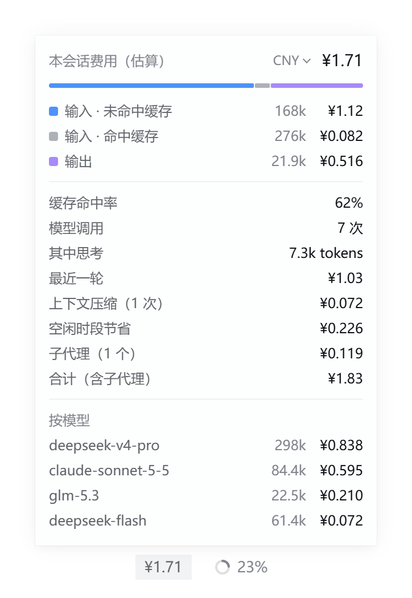
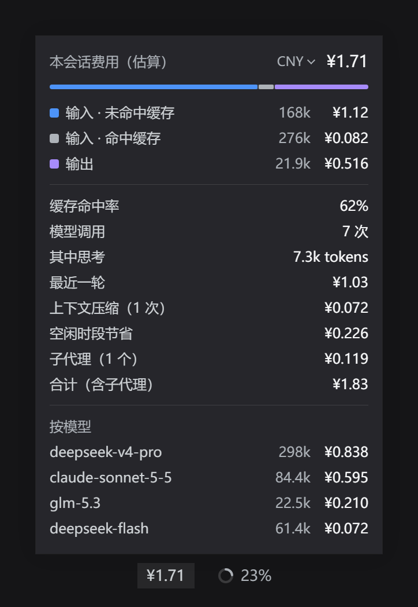
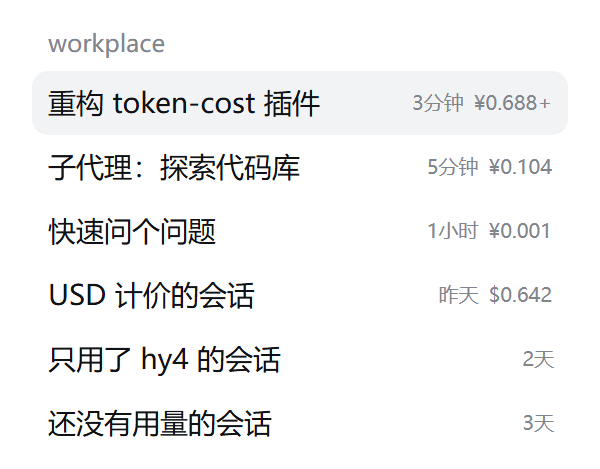

# dsh-token-bill · 对话费用

[English](README.en.md)

[DeepSeek Harness](https://github.com/deepseek-ai/deepseek-harness) 插件：估算**每个对话花了多少钱**。

- **输入框下方**：上下文圆环左边显示本会话的估算费用，点一下展开明细。
- **侧边栏**：会话列表里，每个对话的时间旁边直接显示它的费用，不用点进去。
- **按模型计价**：内置 DeepSeek 官方价格（`deepseek-flash`、`deepseek-v4-pro`，人民币 / 美元两套）；其他模型（例如通过 pi-ai 接入的模型）在配置里补上价格即可。
- **区分高峰 / 空闲时段**：DeepSeek 官方在北京时间工作日 9:00–12:00、14:00–18:00 收高峰价，其余时段（含周末、法定节假日全天）半价。插件按**每次调用发生的时间**分别计价，并显示「空闲时段节省」了多少。
- **算得更全**：上下文压缩（compaction）时的模型调用也计入（内置的 token 计量不含这部分）；子代理的费用单独列出并给出合计；从别的会话分叉出来的会话，不会重复计算继承来的部分。
- **改价立即生效**：会话里只记录 token 数，价格在显示时才套用，改了价格后所有历史会话都按新价格重算。
- 中英文界面，跟随浅色 / 深色主题；零依赖、无需构建。

> 费用由模型返回的 token 用量 × 价格表估算，仅供参考，以实际账单为准。

## 效果

| 明细面板（浅色） | 明细面板（深色） | 侧边栏 |
|---|---|---|
|  |  |  |

<sub>以上为插件代码在 DSH 主题样式下的 2 倍分辨率预览渲染，示例数据：一次高峰时段对话 + 一次夜间（空闲）对话 + 一次上下文压缩 + 一个子代理 + 一个未定价模型 hy4。</sub>

面板里有什么：

| 行 | 含义 |
|---|---|
| 输入 · 未命中缓存 / 命中缓存 / 输出 | 各类 token 数与对应费用；彩条是费用占比。有缓存写入时会多一行「缓存写入」。 |
| 缓存命中率 | 命中缓存的输入 ÷ 全部输入。 |
| 模型调用 | 计费的模型调用次数（失败后重试的那次也算）。 |
| 其中思考 | 输出里的思考（推理）tokens，已包含在「输出」中。 |
| 最近一轮 | 最近一轮对话的费用。 |
| 上下文压缩 | 压缩上下文时的模型调用费用。 |
| 空闲时段节省 | 和全部按高峰价相比省下的钱。 |
| 子代理 / 合计 | 本会话启动的子代理的费用，以及加上它们之后的合计。 |
| 按模型 | 每个模型的 token 与费用；没有价格的模型显示「未定价」。 |

- 金额后面的 `+` 表示有模型没有配置价格，这部分没有计入总额（明细里标为「未定价」）。
- 「子代理」「合计」只在本会话启动过子代理、并且侧边栏已加载它们的数据时出现。

## 安装

需要 DeepSeek Harness **0.2.2-rc.1 或更新版本**。

### 从 GitHub 安装（推荐）

DeepSeek Harness 侧边栏 → **插件** → **添加插件**，填入：

```text
github:leecisen/dsh-token-bill
```

安装完成后点 **立即启用**。

> 请填完整的 `github:leecisen/dsh-token-bill`。只填名字的话，DeepSeek Harness 会去 npm 上找同名的包，那可能是别人的插件。

> 如果连不上 GitHub：在 [Releases](https://github.com/leecisen/dsh-token-bill/releases) 或仓库首页下载 ZIP，解压到一个固定位置，然后在「添加插件」里填这个文件夹的**绝对路径**（例如 `D:\dsh-plugins\dsh-token-bill`）。

### 从旧版（`@local/token-cost`）升级

新版是一个独立的包（包名 `dsh-token-bill`、行 id `dsh-token-bill`），和旧版互不冲突。安装并启用新版后，在 **插件** 页面关闭或卸载旧的 `@local/token-cost` 即可。旧版的 `inputPrice` / `cacheHitPrice` / `outputPrice` 配置仍然可用，会作为「未知模型的兜底价格」。

2.0.0 版当时叫 `dsh-token-cost`（地址 `github:leecisen/dsh-token-cost`）。如果你装过它，先在 **插件** 页面卸载，再按上面的方法安装新版。

## 配置

不配置也能用：默认人民币、区分时段、在侧边栏显示费用。要修改时，在你的 profile 的 `cordis.patch.yml`（Windows 一般在 `%USERPROFILE%\.dsh\profiles\desktop\cordis.patch.yml`）里加一段：

```yaml
- id: dsh-token-bill
  config:
    currency: CNY            # CNY 或 USD 使用内置 DeepSeek 价格；其他币种只用你在 models 里填的价格
    timeOfDayPricing: true   # 区分 DeepSeek 高峰/空闲时段；false = 全部按高峰价（保守上限）
    showInSessionList: true  # 在侧边栏会话列表显示费用
    holidays:                # 额外的法定节假日（北京时间日期），整天按空闲价
      - '2027-01-01'
    models:                  # 每百万 tokens 的价格，单位为 currency
      hy4:                   # 键可以是「模型 id」，也可以是「provider/模型 id」
        input: 0.8           # 输入（未命中缓存）
        cacheHit: 0.2        # 输入（命中缓存），默认等于 input
        output: 2            # 输出
        # cacheWrite: 1      # 缓存写入，默认等于 input
        # offPeak:           # 可选：空闲时段价格，缺的字段沿用上面的值
        #   output: 1
      deepseek-account/deepseek-v4-pro:   # 例：只覆盖某个 provider 下的同名模型
        input: 9
        cacheHit: 0.3
        output: 27
    fallback:                # 可选：所有没有价格的模型都按这个算；不填则显示「未定价」
      input: 2
      cacheHit: 0.5
      output: 8
```

注意：这里的 `config` 会**整体替换**插件自带的配置（DeepSeek Harness 不做合并），没写的字段使用下表中的默认值。

| 字段 | 默认值 | 说明 |
|---|---|---|
| `currency` | `CNY` | 币种代码。`CNY` / `USD` 有内置 DeepSeek 价格。 |
| `symbol` | 随币种（`¥`、`$`…） | 金额前显示的符号。 |
| `timeOfDayPricing` | `true` | 是否区分 DeepSeek 高峰 / 空闲时段。 |
| `showInSessionList` | `true` | 是否在侧边栏会话列表显示每个对话的费用。 |
| `holidays` | 内置 2026 年放假日期 | 追加的节假日，格式 `YYYY-MM-DD`（北京时间）。 |
| `models` | 无 | 自定义 / 覆盖价格。查找顺序：`provider/模型` → `模型` → 内置价格 → `fallback`。 |
| `fallback` | 无 | 兜底价格。旧版的 `inputPrice` / `cacheHitPrice` / `outputPrice` 等同于它。 |

### 内置价格

来自 [DeepSeek 官方价格页](https://api-docs.deepseek.com/zh-cn/quick_start/pricing)，**2026-11-07** 核对，单位：每百万 tokens。

| 模型 | 时段 | 输入（命中缓存） | 输入（未命中缓存） | 输出 |
|---|---|---|---|---|
| `deepseek-flash` | 高峰 | ¥0.04 / $0.006 | ¥2 / $0.30 | ¥8 / $1.20 |
| `deepseek-flash` | 空闲 | ¥0.02 / $0.003 | ¥1 / $0.15 | ¥4 / $0.60 |
| `deepseek-v4-pro` | 高峰 | ¥0.30 / $0.044 | ¥9 / $1.32 | ¥27 / $3.96 |
| `deepseek-v4-pro` | 空闲 | ¥0.15 / $0.022 | ¥4.5 / $0.66 | ¥13.5 / $1.98 |

- 旧模型名 `deepseek-v4-flash`、`deepseek-v4-flash-vision-exp` 按 `deepseek-flash` 计价（与官方一致）。
- 高峰时段：北京时间周一至周五（不含法定节假日）9:00–12:00、14:00–18:00；其余时间均为空闲时段。内置了 2026 年的放假日期；2027 年的安排公布后可用 `holidays` 追加，或升级插件。
- 通过 DeepSeek 账号（`deepseek-account`）使用时，按 API 价格估算，代表「等价 API 费用」；如果你的账号走的是额度/套餐，可以在 `models` 里用 `deepseek-account/<模型>` 把价格改成 0 或你的实际单价。
- 价格可能调整，以官方页面为准；发现过期欢迎提 issue / PR。

## 计算方式

- **Host 端**注册一个会话投影 `dshTokenBill`，重放会话日志里每一次计费的模型调用：`assistant/message`、`assistant/attempt`（失败后重试的那次也计费）和 `compaction/summary`。按「provider + 模型」和「高峰 / 空闲」分桶累计 token：未命中缓存的输入、命中缓存的输入、缓存写入、输出（以及其中的思考 tokens）。
- 同一次尝试里，流式过程中的用量会被最终消息的用量替换；遇到 `llm/retry-started` 后，重试那次单独计费——与内置 token 计量的规则一致。
- 高峰 / 空闲按**事件发生时间**（北京时间）判断，结果可重放、确定。
- 分叉会话：从父会话继承的那部分事件（`inheritedEventCount` 之前）不计费。
- 投影里只存 token；**视图**才按当前价格计价，所以改价立即对所有会话生效。
- **浏览器端**：`conversation.composer.dock` 插槽里的徽标和明细面板读取本会话的投影；`sidebar.session.row.trailing` 插槽从会话列表的摘要数据里读取每个会话的费用。子代理的费用来自 `subagentCatalog` 和会话列表。

## 已知限制

- 估算值：基于模型返回的用量和价格表，不含联网搜索 / 抓取等按次收费的服务，也不含会话标题生成等辅助调用（这些调用没有写入会话日志）。
- 侧边栏只显示已经有摘要数据的会话：安装插件前的老会话，可能要打开一次才会显示费用。
- 子代理费用依赖会话列表里已加载的子会话数据，没加载到时金额后会带 `+`。
- 节假日只内置到 2026 年。

## 开发

```bash
git clone https://github.com/leecisen/dsh-token-bill.git
cd dsh-token-bill
node --test "test/*.test.js"
```

- `index.js`：Host 入口，注册投影。
- `lib/fold.js`：投影的折叠逻辑（纯函数）。
- `lib/pricing.js`：价格表、高峰 / 空闲判断、计价视图（纯函数）。
- `client.js`：浏览器端（纯 JS，无需构建），只依赖 DSH 共享的 `react`、`react-dom` 和 `@deepseek-ai/dsh-client-ui-primitives`。
- `test/`：`node --test` 单元测试，包括在 Node 里渲染浏览器端组件的冒烟测试。

本地调试：在 DeepSeek Harness 的「添加插件」里填仓库文件夹的绝对路径来安装；改完代码后重启 DSH 生效。

## 许可证

[MIT](LICENSE)
